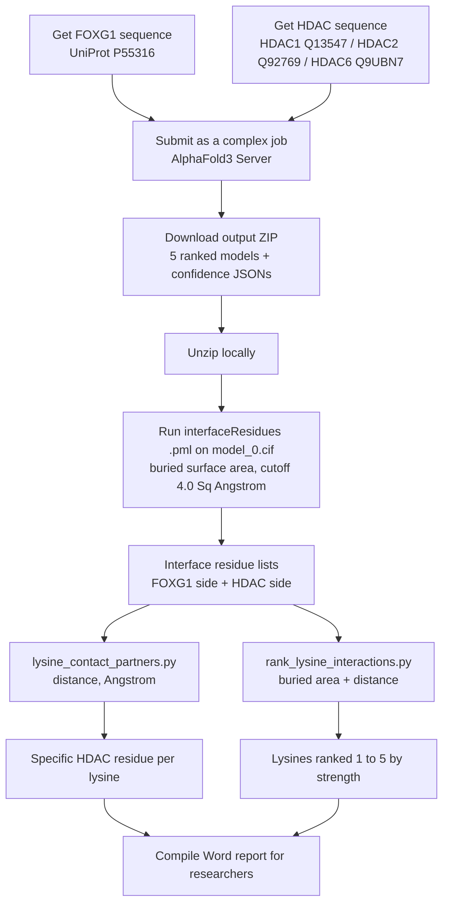
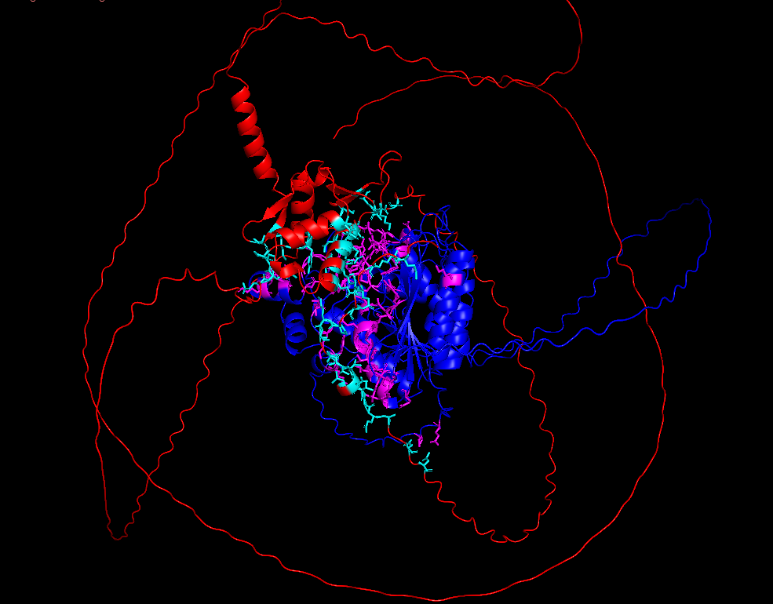
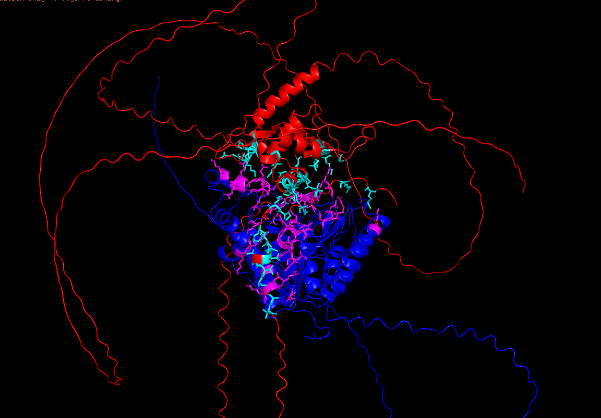
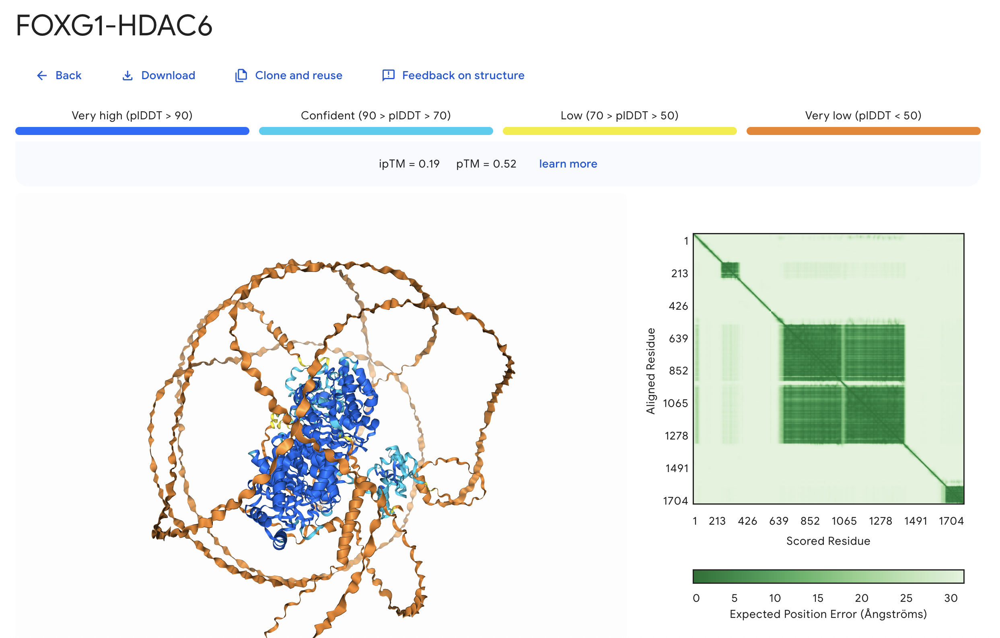
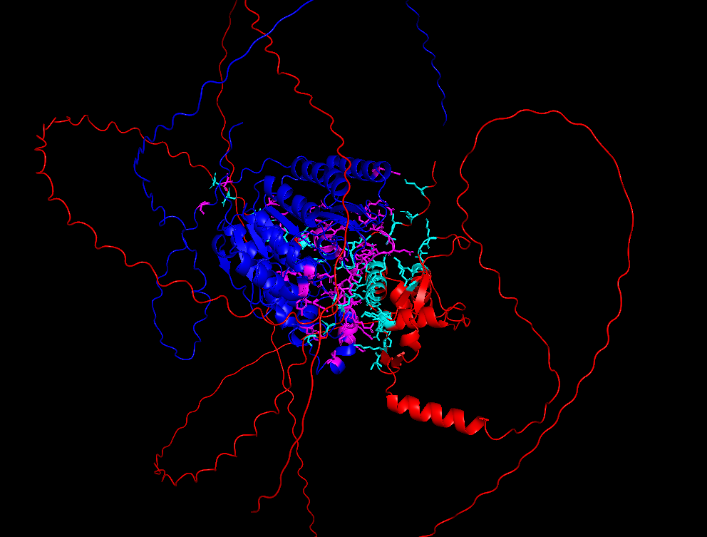
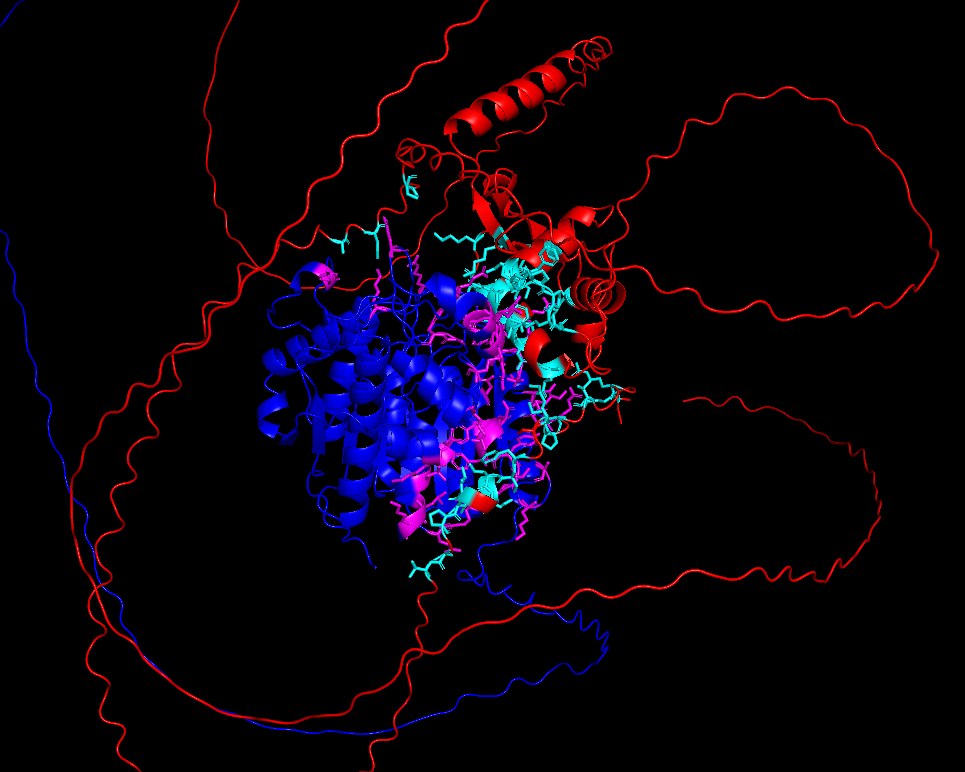
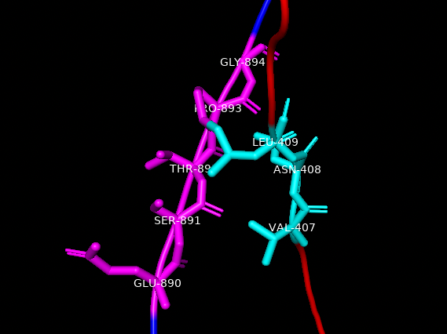

# FOXG1-HDAC interface analysis: which script answers which question

Quick reference for the three analysis scripts built for the FOXG1 x HDAC1/HDAC2/HDAC6
interface work, what each one physically measures, and what question it answers.

## End-to-end workflow

The full process from raw sequences to a researcher-ready report, in order:



1. **Get sequences from UniProt** — canonical FASTA for FOXG1 (P55316) and whichever HDAC
   you're pairing it with (HDAC1 Q13547, HDAC2 Q92769, HDAC6 Q9UBN7).
2. **Submit to AlphaFold3 Server** — both sequences as one multi-chain complex prediction
   job.
3. **Download the output ZIP** — AF3 returns 5 ranked models (`model_0` through `model_4`),
   each with a `summary_confidences` and `full_data` JSON (ipTM, PAE, etc.).
4. **Unzip locally** into a working folder.
5. **Run interface detection** — the `.pml` script (`interfaceResidues`) on `model_0.cif` to
   get the pass/fail interface residue lists for both chains (buried surface area, Ų
   cutoff).
6. **Drill into specific residues** — for lysines of interest (e.g. the 5 shared ones),
   run `lysine_contact_partners.py` to find which specific HDAC residues sit nearby, and
   `rank_lysine_interactions.py` to rank them by buried surface area.
7. **Compile the report** — screenshots, residue lists, and rankings go into the Word
   document for the researchers.

### Example: AlphaFold3 predicted complexes

What step 2-3 actually produces — the raw predicted complex, before any interface analysis:

**FOXG1-HDAC1**


**FOXG1-HDAC2**


**FOXG1-HDAC6**


### Example: PyMOL interface highlighting

What step 5 produces — the same complexes after `interfaceResidues` picks out and highlights
the contact patch:

**FOXG1-HDAC1 interface**


**FOXG1-HDAC2 interface**


## Summary table

| Script | Measures | Units | Answers |
|---|---|---|---|
| Original `.pml` (`interfaceResidues`) | Buried surface area, per-atom threshold | Ų (square angstroms) | "Which residues are at the interface at all?" (pass/fail list) |
| `lysine_contact_partners.py` | Atom-to-atom distance | Å (angstroms) | "Which specific HDAC residue(s) sit near each lysine?" (proximity-based identity) |
| `rank_lysine_interactions.py` | Total buried surface area per lysine (primary) + distance/salt-bridge (secondary) | Ų + Š| "Rank the 5 lysines by interaction strength" (buried area decides rank; distance breaks ties) |

**In one line:** area answers "is it there / how strong," distance answers "with whom specifically."

## Why two different units show up

- **Buried surface area (Ų)** is about how much of a residue's surface gets covered up
  when the two proteins bind — the water-accessibility idea. This is what decides whether
  a residue counts as "interface" at all, and it's the primary basis for ranking the 5
  lysines by strength.
- **Distance (Å)** is a straight-line measurement between two specific atoms. It's what
  tells you which exact HDAC residue sits near a given FOXG1 lysine, and (for the NZ tip
  specifically) whether that lysine's reactive amine is actually positioned toward the
  enzyme rather than just contributing to the interface elsewhere on its side chain.

## A note on "interaction strength"

None of these scripts compute a true binding energy or affinity (no ΔG, no Kd). AlphaFold3
predicts a single static structure, not a measured or calculated binding strength. The
buried-area ranking is a structural proxy — useful for prioritizing which lysine to test
first in the lab — not a substitute for an experimental readout (ITC, SPR) or a rescoring
method (MM-GBSA, FEP) if a defensible affinity-based claim is needed later.

## How to run each script

All three require PyMOL importable as `pymol2`:
```bash
conda install -c conda-forge pymol-open-source
```

### 1. Original `.pml` (interface residues, pass/fail)

Run inside PyMOL, pointed at one AF3 model_0.cif at a time. No command-line
parameters — chain letters and the `cutoff=4.0` (Ų) threshold are edited
directly in the script before each run.

```
run interface-pymol-hdac1.pml
```

### 2. `lysine_contact_partners.py`

```bash
python lysine_contact_partners.py \
    --cif fold_foxg1_hdac1_model_0.cif \
    --foxg1-chain A --hdac-chain B \
    --lysines 15,181,237,241,272
```

| Parameter | Default | Meaning |
|---|---|---|
| `--cif` | *(required)* | Path to the AF3 model_0.cif |
| `--foxg1-chain` | `A` | Chain letter for FOXG1 |
| `--hdac-chain` | `B` | Chain letter for HDAC1/2/6 |
| `--lysines` | `15,181,237,241,272` | Comma-separated FOXG1 residue numbers to check |
| `--cutoff` | `4.5` | Any-heavy-atom contact distance, Å |
| `--nz-cutoff` | `5.0` | NZ-tip-specific contact distance, Å |
| `--salt-cutoff` | `4.0` | Salt-bridge distance (NZ to Asp/Glu O), Å |

Run once per complex (HDAC1, HDAC2, HDAC6).

### 3. `rank_lysine_interactions.py`

```bash
python rank_lysine_interactions.py \
    --cif fold_foxg1_hdac1_model_0.cif \
    --foxg1-chain A --hdac-chain B \
    --lysines 15,181,237,241,272 \
    --label HDAC1 --csv hdac1_ranking.csv
```

| Parameter | Default | Meaning |
|---|---|---|
| `--cif` | *(required)* | Path to the AF3 model_0.cif |
| `--foxg1-chain` | `A` | Chain letter for FOXG1 |
| `--hdac-chain` | `B` | Chain letter for HDAC1/2/6 |
| `--lysines` | `15,181,237,241,272` | Comma-separated FOXG1 residue numbers to rank |
| `--cutoff` | `4.5` | Heavy-atom contact distance, Å (for contact count / min distance) |
| `--salt-cutoff` | `4.0` | Salt-bridge distance, Å |
| `--label` | `""` | Cosmetic name for the printed header (e.g. `HDAC1`) |
| `--csv` | *(none)* | Optional path to write the ranked table as CSV |

Run once per complex; compare the three printed/CSV tables side by side.

## The 5 shared lysines (for reference)

K15, K181, K237, K241, K272 — confirmed present across the FOXG1-HDAC1, FOXG1-HDAC2, and
FOXG1-HDAC6 (wild-type) predicted interfaces. Note: in one HDAC6 analysis, K15 was found in
a spatially separate contact region ("bottom" interface, FOXG1 N-terminal region) from the
other four (K181/K237/K241/K272, "top" interface, FOXG1 C-terminal region) — i.e. not
literally one shared contact patch for that complex.

### FOXG1-HDAC6 low-confidence region check

Close-up from the combined FOXG1-HDAC6 analysis, showing the region flagged as low-confidence
(residues VAL407/ASN408/LEU409 on FOXG1, GLU890-GLY894 on HDAC6). Worth checking whether any
of the 5 shared lysines fall in a similarly flagged region before treating that contact as
fully confirmed.



