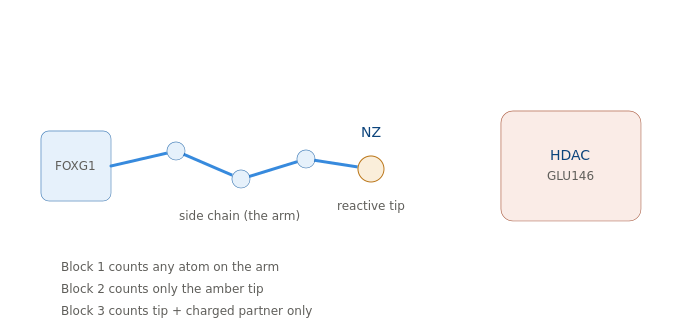

# Reading the output of `lysine_contact_partners.py`

How to interpret the three blocks printed for each lysine, what they measure, and why
they get progressively stricter.

Companion to `script_measurement_summary.md` (which covers which script answers which
question).

## First: lysine anatomy

A lysine isn't a blob — it has a long, flexible side chain that sticks out from the
protein backbone like an arm, with a reactive nitrogen atom (**NZ**) at the very tip.

That tip is the business end. It's what gets an acetyl tag attached, and what an HDAC
enzyme has to grab and pull into its catalytic tunnel to remove that tag. Everything
else on the arm is just the reach that gets the tip into position.



This distinction matters: a lysine can be sitting at the interface with its arm brushing
against the enzyme, while its reactive tip points off in a completely different direction.
For a deacetylation hypothesis, only the tip's position matters.

## The three blocks

All three measure the same physical thing — straight-line distance between atoms, in
angstroms (Å) — but each applies a narrower filter than the last.

| Block | What it counts | Cutoff | Question it answers |
|---|---|---|---|
| 1. Any-atom contacts | Any heavy atom anywhere on the lysine, near any HDAC atom | 4.5 Å (`--cutoff`) | Is anything near this lysine at all? |
| 2. NZ-tip-specific | Only the reactive NZ tip, near any HDAC atom | 5.0 Å (`--nz-cutoff`) | Is the *important part* near the enzyme? |
| 3. Candidate salt bridge | NZ tip near a negatively charged Asp/Glu carboxylate oxygen specifically | 4.0 Å (`--salt-cutoff`) | Is this a real chemical interaction? |

Think of them as three sieves getting finer:
**is anything near it → is the important part near it → is it a genuine chemical bond.**

### Block 1 — any-atom contacts

The widest net. Catches any HDAC residue that has an atom within 4.5 Å of *any* atom on
the lysine, including partway down the arm. Useful for "what's in the neighborhood," but
it doesn't tell you whether the contact is mechanistically meaningful.

### Block 2 — NZ-tip-specific contacts

Same distance measurement, but only from the tip. Residues that appear in Block 1 but
drop out of Block 2 are near the arm but *not* near the reactive end — worth noting, but
not evidence for a deacetylation site.

The cutoff here is slightly looser (5.0 Å vs 4.5 Å) because HDAC catalytic tunnels are
deep, so this also flags residues lining the approach to the tunnel, not just those in
direct contact.

### Block 3 — candidate salt bridges

The strictest filter, and the only one that adds a *chemistry* requirement on top of
distance. Lysine's NZ tip carries a positive charge. Asp and Glu carboxylates carry a
negative charge. Positive meeting negative at close range is a genuinely attractive,
stabilizing interaction — a real chemical bond, not just two atoms happening to be near
each other.

A lysine that passes all three filters has the strongest structural case of the set.

## Worked example: FOXG1 K15 vs HDAC1

```
=== FOXG1 K15 ===
  Any-atom contacts within 4.5 A:
    GLU146 (chain B)  2.61 A
    GLU185 (chain B)  4.23 A
  NZ-tip-specific contacts within 5.0 A:
    GLU146:OE1  2.61 A
  Candidate salt bridge(s) (NZ near Asp/Glu carboxylate):
    K15:NZ -- GLU146:OE1  2.61 A
    K15:NZ -- GLU146:OE2  3.08 A
```

Reading it:

- **GLU185 appears in Block 1 but not Block 2.** It's near the arm somewhere, but not
  near the reactive tip. Real proximity, limited mechanistic significance.
- **GLU146 survives all three blocks.** Its carboxylate oxygens sit 2.61 Å and 3.08 Å
  from the NZ tip — a bidentate salt bridge (both oxygens engaged). This is textbook, and
  the strongest single contact in the FOXG1-HDAC1 lysine set.

## Two gotchas worth knowing

**A residue can appear in Block 2 but not Block 1.** The NZ cutoff (5.0 Å) is looser than
the any-atom cutoff (4.5 Å), so something at, say, 4.86 Å shows up in the tip-specific
list while being filtered out of the any-atom list. Not a bug — the two cutoffs are
independent knobs.

**"No contacts" doesn't contradict the interface residue list.** A lysine can pass the
`interfaceResidues` test (buried surface area, Ų) while having zero atoms within 4.5 Å.
Burial is detected out to ~7-8 Å because the water probe gets excluded well before atoms
actually touch. Such a lysine is a *second-shell residue* — near enough to lose solvent
accessibility, not near enough to touch anything. For a deacetylation hypothesis, that's
the weakest possible position: an HDAC can't act on a lysine whose tip never reaches the
catalytic tunnel.

## Adjusting the cutoffs

All three are command-line flags, so you can tighten or loosen any of them independently:

```bash
python lysine_contact_partners.py \
    --cif fold_foxg1_hdac1_model_0.cif \
    --foxg1-chain A --hdac-chain B \
    --lysines 15,181,237,241,272 \
    --cutoff 4.5 --nz-cutoff 5.0 --salt-cutoff 4.0
```
